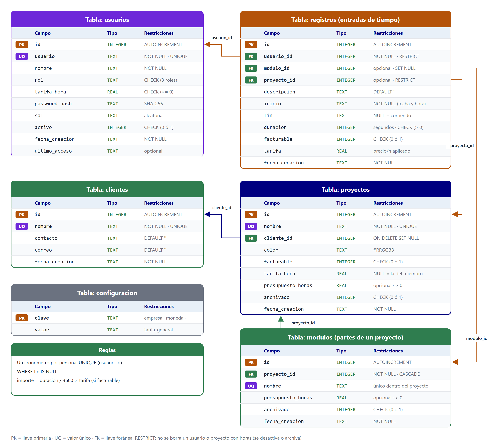
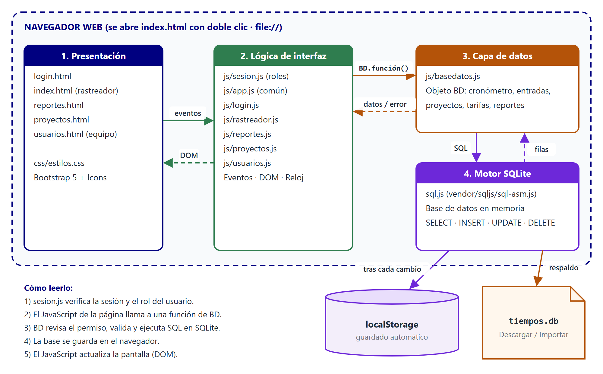

<p align="center"></p>

# Control de Tiempo

Sistema web para que una empresa de servicios registre **en qué trabaja cada persona, para qué proyecto y cliente, cuánto tiempo y cuánto dinero representa**. Funciona como las herramientas de registro de horas tipo Clockify: escribes "¿En qué estás trabajando?", eliges el proyecto y presionas **INICIAR**; al terminar, **DETENER**. Cada proyecto tiene su **tarifa por hora**, y los **reportes** muestran horas, horas facturables e importe por periodo, proyecto, cliente y miembro.

> Proyecto Final · Programación Web
> HTML5 · CSS3 · Bootstrap 5 · JavaScript · SQLite (sql.js)

**No requiere instalar nada:** se abre `index.html` con doble clic y funciona, incluso sin internet.

📄 **Documentación completa** (arquitectura, base de datos, diagramas, tarifas, roles, explicación del código, manual de usuario y guía para la entrevista): [docs/Documentacion_ControlTiempo.docx](docs/Documentacion_ControlTiempo.docx)

---

## 🚀 Instrucciones de ejecución

1. Descarga el proyecto (**Code → Download ZIP** en GitHub) y descomprímelo, o clónalo:
   ```bash
   git clone https://github.com/<tu-usuario>/control-tiempo.git
   ```
2. Abre la carpeta y haz **doble clic en `index.html`**.
3. Entra con uno de los usuarios de prueba (en la pantalla de acceso hay botones que los llenan):

| Usuario | Contraseña | Rol | Tarifa/h |
|---|---|---|---|
| `admin` | `admin123` | Administrador | $500 |
| `daniel` | `daniel123` | Colaborador (Daniel Valladolid) | $380 |

> La primera vez se cargan 2 clientes, 5 proyectos y 23 entradas de tiempo de los últimos días.
> En un uso real, el administrador debe cambiar estas contraseñas desde **Equipo**.

---

## ✨ Funcionalidades

| Página | Archivo | Qué hace |
|---|---|---|
| **Acceso** | `login.html` | Inicio de sesión con usuario y contraseña. |
| **Rastreador** | `index.html` | Cronómetro (INICIAR / DETENER), modo manual, botón **$** facturable, totales de hoy y de la semana, entradas agrupadas por día con **▶ continuar**, editar y eliminar. |
| **Reportes** | `reportes.html` | Filtros por periodo, miembro, cliente, proyecto y facturable; totales, gráfica de horas por día, desglose por proyecto y miembro, detalle y **exportar CSV**. |
| **Reporte PDF** | `reporte-pdf.html` | Reporte de actividades en **hoja membretada** con la **firma** (PNG) y el nombre al final. Se abre con **Exportar PDF** en Reportes y se guarda con "Guardar como PDF". |
| **Proyectos** | `proyectos.html` | Proyectos (color, cliente, tarifa, facturable, presupuesto de horas, archivar), sus **módulos** y clientes. |
| **Equipo** | `usuarios.html` | Usuarios con rol y tarifa por hora, ajustes (empresa, moneda, tarifa general), respaldo de la BD y matriz de permisos. Solo administrador. |

**Detalles tipo Clockify:**
- El cronómetro **sigue corriendo** aunque cambies de página o cierres el navegador; el menú muestra **● 0:12:34** y la pestaña del navegador muestra el tiempo.
- Solo **un cronómetro por persona**: al iniciar otro, el anterior se detiene.
- Entradas que cruzan la medianoche (22:00 → 01:00) se registran bien.
- **Tarifa** de cada entrada: la del proyecto, si tiene; si no, la del miembro; si no, la general. Se copia en la entrada para que un cambio de precio no altere lo ya trabajado.
- **Importe** = horas × tarifa, solo si la entrada es facturable.
- **Módulos por proyecto** (ej. Glosa, Balance, Flujo de efectivo): se eligen junto al proyecto al registrar tiempo y en Reportes se ve el tiempo, el % del proyecto y el importe de cada módulo.

---

## 🔐 Roles y permisos

| Acción | Administrador | Colaborador | Consulta |
|---|:---:|:---:|:---:|
| Usar el cronómetro y registrar tiempo | ✅ | ✅ (propio) | ❌ |
| Corregir o eliminar el tiempo de otros | ✅ | ❌ | ❌ |
| Ver reportes | ✅ todo el equipo | ✅ solo sus horas | ✅ todo el equipo |
| Ver proyectos y clientes | ✅ | ✅ | ✅ |
| Crear y editar proyectos, clientes y tarifas | ✅ | ❌ | ❌ |
| Administrar equipo, ajustes y respaldo de la BD | ✅ | ❌ | ❌ |

- Contraseñas guardadas como **hash SHA-256 + sal**, nunca como texto.
- Permisos en **dos capas**: la interfaz oculta lo que no se puede usar y la capa de datos lo rechaza aunque se intente desde la consola.

---

## 🗄️ Base de datos



| Tabla | Para qué |
|---|---|
| `usuarios` | Cuentas: usuario único, nombre, rol, **tarifa por hora**, hash y sal de la contraseña, activo. |
| `clientes` | Empresas a las que se cobra: nombre, contacto, correo. |
| `proyectos` | Nombre, cliente, color, facturable, tarifa por hora, presupuesto de horas, archivado. |
| `modulos` | Partes de un proyecto: nombre (único dentro del proyecto), presupuesto de horas, archivado. |
| `registros` | **Entradas de tiempo:** usuario, proyecto, módulo, descripción, inicio, fin (vacío = corriendo), duración en segundos, facturable y tarifa aplicada. |
| `configuracion` | Empresa, moneda (MXN/USD/EUR) y tarifa general. |

Relaciones con **llaves foráneas**: `registros` → `usuarios` y `proyectos` (`RESTRICT`: no se borra a nadie con horas, se desactiva o archiva); `proyectos` → `clientes` (`SET NULL`); `modulos` → `proyectos` (`CASCADE`); `registros` → `modulos` (`SET NULL`: si se borra un módulo, sus horas quedan "sin módulo"). Las bases creadas antes de los módulos se actualizan solas al abrirlas o importarlas. Un **índice único parcial** impide dos cronómetros corriendo para la misma persona.

Los datos se guardan automáticamente en el navegador; el administrador puede **Descargar / Importar** el archivo `tiempos.db` (SQLite real, se abre con [DB Browser for SQLite](https://sqlitebrowser.org)).

---

## 🏗️ Arquitectura



Más diagramas en [docs/diagramas](docs/diagramas): secuencia del cronómetro, cálculo de la tarifa, mapa de navegación, control de acceso, persistencia y validación.

---

## 🛠️ Tecnologías utilizadas

| Capa | Tecnología | Uso |
|---|---|---|
| Estructura | **HTML5 semántico** | `header`, `nav`, `main`, `section`, `article`, `footer` |
| Estilos | **Bootstrap 5.3** + CSS propio | Diseño responsivo, tablas, tarjetas, formularios, modales, pestañas, toasts |
| Íconos | **Bootstrap Icons 1.11** | Iconografía |
| Interactividad | **JavaScript (ES2020+)** | DOM, eventos, `async/await`, reloj con `setInterval`, gráfica y CSV sin librerías |
| Base de datos | **SQLite** vía **sql.js 1.10** | SQL real en el navegador (JOIN, GROUP BY, llaves foráneas, índices) |
| Seguridad | **Web Crypto API** | Hash SHA-256 de contraseñas |
| Persistencia | **localStorage / sessionStorage** + archivo `.db` | Datos, sesión y respaldo |

Todas las librerías están en `vendor/`, por eso funciona sin internet.

---

## 📁 Estructura del proyecto

```
PROYECTO/
├── index.html          # Rastreador de tiempo  ← ABRIR ESTE
├── login.html          # Inicio de sesión
├── reportes.html       # Reportes y exportación CSV
├── proyectos.html      # Proyectos y clientes
├── usuarios.html       # Equipo, tarifas y ajustes (solo admin)
├── reporte-pdf.html    # Reporte en hoja membretada con firma (para PDF)
├── css/
│   ├── estilos.css     # Estilos propios (colores y tipografía de la marca)
│   └── reporte-pdf.css # Hoja carta, membrete en cada hoja, firma
├── img/                # Logotipo, membrete.png y firma.png
├── js/
│   ├── basedatos.js    # Capa de datos: SQLite, cronómetro, tarifas, reportes
│   ├── sesion.js       # Sesión, roles, permisos e indicador del cronómetro
│   ├── app.js          # Utilidades comunes (H:MM:SS, dinero, alertas)
│   ├── login.js · rastreador.js · reportes.js
│   └── proyectos.js · usuarios.js · reporte-pdf.js
├── data/tiempos.db     # Base de datos SQLite de ejemplo (entregable)
├── vendor/             # Bootstrap, Bootstrap Icons, sql.js y Montserrat (copias locales)
├── docs/
│   ├── Documentacion_ControlTiempo.docx
│   └── diagramas/
└── README.md
```

---

## 🎨 Identidad visual

Según el manual de identidad corporativa:

| Elemento | Valor |
|---|---|
| Azul principal (la "V" del logotipo) | `#0000B6` |
| Azul marino (la flecha del logotipo) | `#000080` |
| Tipografía | **Montserrat** (copia local en `vendor/montserrat`, licencia OFL) |
| Logotipo | `img/logo.png` (color) y `img/logo-blanco.png` (sobre fondos azules), sin el círculo exterior |

El logotipo solo se escala por altura para respetar su proporción, sin rotarlo, deformarlo ni ponerle sombras, como indica el manual.

---

## 🧩 ¿Qué pasa si quito algo?

Probado en una copia del proyecto, quitando un archivo a la vez:

| Si quitas… | Qué pasa |
|---|---|
| `js/basedatos.js`, `vendor/sqljs/`, `js/sesion.js`, `js/app.js`, `vendor/bootstrap/` | **Indispensables:** el sistema deja de funcionar. |
| El JS de una página (`rastreador.js`, `reportes.js`, `proyectos.js`, `reporte-pdf.js`) | Solo esa página deja de funcionar. |
| `img/membrete.png` / `img/firma.png` | El PDF sale sin membrete / con la línea y el nombre pero sin firma. |
| `css/estilos.css`, `vendor/montserrat/`, `vendor/bootstrap-icons/`, logos | Solo cambia la apariencia. |
| `data/tiempos.db`, `docs/` | Nada: son entregables (el sistema usa la base guardada en el navegador). |

Al **eliminar datos**: un módulo deja sus horas "sin módulo"; un cliente deja sus proyectos "sin cliente"; un proyecto o usuario con horas no se borra (se archiva o desactiva).

---

## 🔒 Buenas prácticas aplicadas

- **Validación en tres capas**: formulario, capa de datos y restricciones `NOT NULL`, `UNIQUE`, `CHECK` y `FOREIGN KEY`.
- **Consultas preparadas** (`?`) → protección contra inyección SQL.
- **Escape de HTML** → protección contra XSS.
- Totales e importes calculados con SQL (`SUM`, `GROUP BY`) en lugar de guardarse duplicados.
- Código comentado en español en todos los archivos.
- Probado de punta a punta en Microsoft Edge: 90 verificaciones (roles, cronómetro, tarifas, módulos, reportes, PDF con membrete y firma, CRUD, migración, móvil).

> **Alcance:** al correr en el navegador, el control de acceso organiza el trabajo y protege las contraseñas, pero no equivale a la seguridad de un servidor.

---

## 🔮 Mejoras futuras

- Versión con servidor (Node.js/Express) para compartir la base entre todo el equipo.
- Vista de calendario y hoja de horas semanal.
- Etiquetas, tareas por proyecto, aprobación de horas y facturas en PDF.

---

## 👤 Autor

**Daniel Valladolid** — Proyecto Final de Programación Web.
